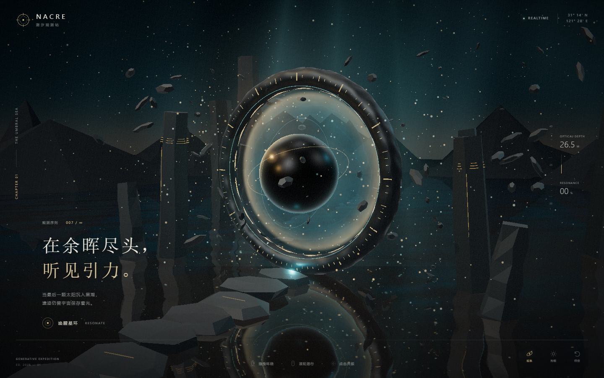

# NACRE — 潮汐观测站

> 在余晖尽头，听见引力。

**NACRE** 是一件可以直接在浏览器中运行的交互式三维视觉作品。黑潮淹没远古观测站，日蚀星环仍在水面上运转；引力核心、漂浮遗迹与星尘共同保存着宇宙最后的光。

项目基于 **Three.js / WebGL 2**，所有纹理均由程序生成。无需后端、无需外部贴图、无需 CDN，下载后即可离线体验。



## 作品亮点

- **完整空间叙事**：残损朝圣道、日蚀星环、引力核心、远古观测碑与远山构成前、中、远景层次。
- **实时黑镜水面**：使用真实镜面反射渲染，并针对深色水体调整反射率、散射与波纹扰动。
- **程序化视觉材质**：玄武岩、金属刻线、日蚀星幕、引力边缘光与水面法线均由代码生成。
- **动态粒子系统**：星尘、漂浮碎片、轨道微光、点击爆发粒子与扩散涟漪持续响应场景状态。
- **电影化后期**：Bloom、暗角、轻微色差、胶片颗粒与 ACES 色调映射共同塑造画面。
- **双光相**：在「余晖金」与「极夜蓝调」之间平滑切换。
- **自适应性能**：限制高分屏像素比，并在低帧率时自动降低渲染分辨率。

## 快速体验

### 方式一：直接打开（推荐）

双击项目根目录的 **`index.html`**。

全部运行资源已经打包在本地，不需要执行安装命令，也不需要联网。请使用开启硬件加速的最新版 Chrome、Edge 或 Firefox。

### 方式二：启动本地服务

需要 Node.js 18 或更高版本：

```bash
npm run serve
```

然后访问：

```text
http://127.0.0.1:4173
```

## 交互方式

| 操作 | 场景反馈 |
| --- | --- |
| 鼠标左键拖曳 | 自由环绕观察 |
| 鼠标右键拖曳 | 平移观察目标 |
| 滚轮 | 拉近或拉远，联动景深、雾气与泛光 |
| 悬停星环、核心、石碑或碎片 | 显示物体名称与交互提示 |
| 点击星环 / 引力核心 | 激发共振、冲击波与引力粒子 |
| 点击石碑 / 漂浮碎片 | 读取残存频率或施加轨道扰动 |
| 点击水面 | 生成扩散涟漪 |
| `A` | 开启或暂停自动巡航 |
| `L` | 切换余晖金 / 极夜蓝光相 |
| `R` | 平滑回到初始观察位置 |
| `Space` | 唤醒引力核心 |

也可以在页面右下角使用巡航、光相与归位按钮。

## 本地开发

安装依赖：

```bash
npm install
```

启动监听构建：

```bash
npm run dev
```

生成可直接部署的本地包：

```bash
npm run build
```

`npm run build` 会将 `src/main.js` 及其 Three.js 依赖打包为 `bundle.js`。修改源码后需要重新构建，直接打开 `index.html` 才能看到最新效果。

## 项目结构

```text
nacre-tidal-observatory/
├── index.html          # 页面入口与交互界面
├── styles.css          # 视觉界面、动效与响应式布局
├── src/
│   └── main.js         # 场景、着色器、粒子、交互与后期处理
├── bundle.js           # 已打包的本地运行文件
├── server.cjs          # 零额外依赖的本地静态服务
├── preview.png         # 作品预览图
└── package.json        # 构建与开发脚本
```

## 技术实现

- Three.js 场景、物理材质与环境光照
- OrbitControls 阻尼视角、平移、缩放与自动巡航
- Water 实时平面反射与自定义黑水散射参数
- GLSL 星幕、引力边缘光、光柱与粒子着色器
- InstancedMesh 轨道碎片与发光微粒
- EffectComposer、UnrealBloomPass、ShaderPass 与 OutputPass
- Raycaster 悬停识别和分对象点击反馈
- WebGL 2、自适应像素比与桌面视口适配

## 开源与修改权限

本项目源码采用 **[MIT License](LICENSE)** 开源。

需要特别区分“源码许可”与“原仓库写入权限”：

- **原仓库仅作者及作者明确授权的协作者拥有写入权限。** 其他 GitHub 用户不能直接推送、删除或修改本仓库源码。
- 外部用户提交的 Pull Request 只有在作者亲自审核并合并后，才会改变原仓库内容；不会产生自动合并。
- MIT 许可证允许他人在保留版权与许可声明的前提下使用、复制、修改和分发其自己的副本。Fork 副本的修改不会自动影响本仓库。
- 欢迎通过 Issues 提交问题与体验建议；代码修改类 Pull Request 仅在作者明确认可后合并。

## 浏览器要求

需要支持 **WebGL 2** 的现代桌面浏览器，并建议开启硬件加速。若浏览器禁用 WebGL 或显卡驱动不可用，页面会显示启动提示。

---

**NACRE / GENERATIVE EXPEDITION · ED. 2026—01**
